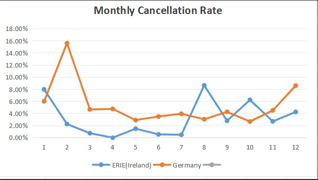

# Excel-Retail-Sales-Analysis.
Retail sales and cancellation analysis in Excel and Pandas.
A practice project that answers 10 business questions on retail sales and order cancellations using Excel-style tools (SUMIFS, COUNTIFS, PivotTables, XLOOKUP + IFERROR) and Pandas for data cleaning.
It uses the same dataset as my SQL project: Retail-Sales-Cancellation-Analysis.
Dataset
Size: 536,612 order lines
Period: December 2010 to December 2011
Main fields: InvoiceNo, StockCode, product name, Quantity, UnitPrice, InvoiceDate, CustomerID, country, LineTotal, is_cancelled
Cancelled order lines are stored as negative values, so sums that include them are net figures.
Tools
WPS Office Spreadsheets (Excel-compatible): formulas, PivotTables, charts
Python (Pandas) in Jupyter Notebook: data cleaning
Power Query was not available in my environment, so I did the cleaning in Pandas.
Questions and results
#
Question
Method
Result
1
Total sales per country
PivotTable
See analysis sheet and dashboard chart
2
Cancellations per country
PivotTable (distinct invoices, is_cancelled = TRUE)
See analysis sheet
3
Cancellation rate per product
PivotTable + calculated rate
See analysis sheet
4
Average order value (AOV) per country
Sales / distinct invoices
See analysis sheet
5
Sales of one product in one country
SUMIFS with two conditions
2,349.53 (GLASS STAR FROSTED T-LIGHT HOLDER, United Kingdom)
6
Cancelled orders of one product in one month
COUNTIFS with two conditions
[RESULT] (month 1, January)
7
Cancelled sales excluding one country
SUMIFS with "<>" criterion
-31,493.92 (excluding United Kingdom)
8
Sales and cancellation rate by month and country
PivotTable (rows = month, columns = top 5 countries)
See analysis sheet and dashboard chart
9
Import and clean the data
Pandas (see data_cleaning.ipynb)
109 duplicate product-code variants merged
10
Price lookup table
IFERROR + XLOOKUP
See price_lookup sheet
The exact formula or method for each question is listed in the formulas_used sheet.
Data cleaning (Question 9)
Removed fully empty rows: 0 found (536,612 rows before and after).
Standardized StockCode with trim + uppercase: unique codes went from 3,925 to 3,816 (109 variants merged, for example 15056bl and 15056BL).
Questions 3, 5 and 6 group by product name, so I checked that the code cleaning did not change their results.
Details are in the cleaning_log sheet.
Key observations
The United Kingdom accounts for almost all sales (about 8.78 million, against about 0.28 million for the next country, the Netherlands).
Among the five countries in Question 8, Germany has the highest overall cancellation rate (4.80% of order lines) and the Netherlands the lowest (0.17%). EIRE is at 3.25% and France at 1.64%.
Cancelled sales outside the United Kingdom total -31,493.92.
Notes and limitations
Month 12 combines two Decembers (December 2010 and a partial December 2011). Months 1 to 11 are from 2011 only. Read Question 8 and the monthly chart with this in mind.
Cancellation rate in this project is the share of order lines flagged as cancelled, not a share of quantity or value.
data_sample contains the first 1,000 rows of the cleaned data, included only to illustrate the data structure. The full dataset (536,612 rows) was used for all analysis, but it is not included because of its size.
Formulas: because the full data sheets are not in the lite workbook, results are stored as values. The formulas used are documented in formulas_used.
The dashboard sales chart excludes the United Kingdom, because it is far larger than every other country.
Files
File
Description
Excel_Retail_Project.xlsx
Workbook: dashboard, formulas_used, cleaning_log, price_lookup, analysis, data_sample
data_cleaning.ipynb
Pandas cleaning steps (place the original workbook in the same folder to run it)
screenshots/
Dashboard and PivotTable screenshots
What I learned
Writing SUMIFS and COUNTIFS with multiple conditions, and using XLOOKUP with IFERROR for safe lookups.
Building PivotTables with a calculated cancellation rate.
Checking how a cleaning step affects results before trusting them.
Documenting limitations (such as the repeated December) instead of hiding them.

## Screenshots

